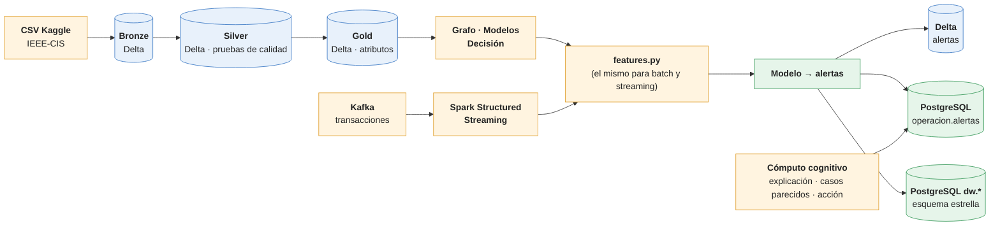

<div align="center">

<h1>Detección de Fraude en Transacciones Digitales</h1>
<h3>Lakehouse con Spark, Kafka y PostgreSQL sobre datos reales (IEEE-CIS) — PP 25 v2</h3>

<p>
  
  
  
  
</p>
<p>
  
  
  
  
</p>
<p>
  
  
  
  
</p>

<blockquote>
<strong>Meta:</strong> un pipeline de punta a punta que detecta fraude sin fugas de información: partición temporal, atributos calculados solo con el pasado y un único módulo de atributos para batch y streaming.
</blockquote>
</div>

---

> **Proyecto académico (UNRC).** Usa el dataset público IEEE-CIS de Vesta (Kaggle). Los datos no se incluyen en el repositorio; el paso 01 los descarga con `kagglehub`.

## Tabla de contenidos

- [Qué es](#qué-es)
- [Arquitectura](#arquitectura)
- [Resultados](#resultados)
- [Estructura del repositorio](#estructura-del-repositorio)
- [Cómo correrlo](#cómo-correrlo)
- [Versión original](#versión-original)

---

## Qué es

Esta versión rehace el proyecto original después de una **auditoría** (`fraude-pipeline/notebooks/01_auditoria_modelo_fraude.ipynb`) que encontró cuatro problemas: datos sintéticos con una regla obvia, partición aleatoria, atributos distintos entre entrenamiento y streaming, y un umbral sin costo. La versión corregida:

- Parte de **datos reales** (590,540 transacciones, 3.5 % de fraude).
- Separa el tiempo en entrenamiento (días 1–120), validación (121–150) y prueba (151–183).
- Usa **un solo `features.py`** para batch y streaming, y lo comprueba con una prueba automática.
- Elige modelo y umbral **solo con validación**, y mide el costo de revisar.

El detalle de cada paso, los resultados y las limitaciones están en [`fraude-pipeline/README.md`](fraude-pipeline/README.md).

## Arquitectura



| Paso | Qué hace |
|---|---|
| `01_bronze` · `02_silver` · `03_gold` | CSV → Delta, pruebas de calidad y atributos en el punto del tiempo |
| `04_grafo` | Grafo cliente–dispositivo y anillos de fraude (matemáticas discretas) |
| `05_modelos` | GBT y regresión logística en Spark MLlib, con ablación y calibración |
| `06_decision` | Regla de Bayes, mochila con capacidad y colas M/M/c con Monte Carlo |
| `07_productor_kafka` · `08_consumidor_streaming` | Flujo en tiempo real con los mismos atributos |
| `09_paridad` | Prueba de que streaming y batch dan la misma probabilidad |
| `10_data_warehouse` | Esquema estrella y consultas OLAP en PostgreSQL |
| `11_cognitivo` | Explicación en español, casos parecidos y acción sugerida |

## Resultados

Mes de prueba: 94,635 transacciones y 3,282 fraudes.

| Modelo | PR-AUC prueba | ROC-AUC | Recall revisando 3.35 % |
|---|---|---|---|
| GBT con columnas originales | 0.461 | 0.890 | 46.1 % |
| GBT con todos los atributos | 0.488 | 0.903 | 48.0 % |
| **Regresión logística (elegida por validación)** | **0.558** | **0.922** | **53.6 %** |

- **Paridad batch–streaming:** diferencia máxima 0 en 94,635 transacciones.
- **Anillos de fraude:** 219 componentes con 2 o más clientes defraudadores, contra 74 esperadas al azar.
- **Ordenar por pérdida esperada** (probabilidad × monto) recupera 63 % del dinero, contra 42 % si se ordena solo por probabilidad.

Las limitaciones (columnas V, costo de revisión supuesto, identidad de cliente aproximada) están en el README de la carpeta.

## Estructura del repositorio

```
pp25-v2/
├── fraude-pipeline/        versión corregida (la vigente)
│   ├── pasos/              01 a 11, uno por etapa
│   ├── src/                config, sesión de Spark, features y modelado
│   ├── sql/                esquemas de operación y data warehouse
│   ├── notebooks/          auditoría del original y prueba con datos reales
│   ├── reporte/            resultados (CSV, JSON y figuras)
│   ├── docker-compose.yml  Kafka y PostgreSQL
│   └── correr_todo.sh
├── Deteccion_fraude/       versión original (MySQL y MongoDB)
├── proyectoPP/             versión original (carga a Delta Lake)
└── files.zip               asistente de negocio con voz; proyecto aparte
```

## Cómo correrlo

Requiere Docker, Java 17 o 21 y Python 3.10+.

```bash
cd fraude-pipeline
docker compose up -d
pip install -r requirements.txt
```

```bash
# Datos: coloca train_transaction.csv y train_identity.csv en datos/ieee-cis (git los ignora, pesan 710 MB),
# o apunta a otra carpeta con RUTA_IEEE; si no hay nada, se descargan con kagglehub
export RUTA_IEEE=/ruta/a/ieee-cis    # opcional
./correr_todo.sh                     # ~45 min en una laptop de 2 núcleos y 8 GB
```

## Versión original

`Deteccion_fraude/` y `proyectoPP/` conservan la primera versión (datos sintéticos, MySQL y MongoDB). Se dejan por historia: la auditoría explica por qué se reemplazó.

<div align="center">
<sub>Licenciatura en Ciencia de Datos para el Negocio · UNRC</sub>
</div>
