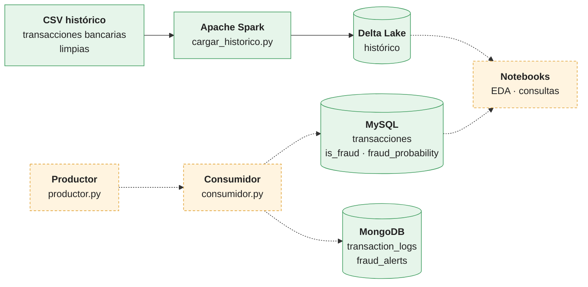

<div align="center">

<h1>Detección de Fraude Bancario</h1>
<h3>Pipeline de datos con Spark, Delta Lake, MySQL y MongoDB — PP 25 v2</h3>

<p>
  
  
  
  
</p>
<p>
  
  
  
  
</p>

<blockquote>
<strong>Meta:</strong> detectar transacciones bancarias fraudulentas combinando un lakehouse para el histórico, una base relacional para las transacciones y una base documental para los registros y alertas.
</blockquote>
</div>

---

> **Proyecto académico (UNRC).** El dataset es una colección de transacciones bancarias **sintéticas**; los nombres de clientes y cuentas no corresponden a personas reales.

## Tabla de contenidos

- [Qué es](#qué-es)
- [Estado del proyecto](#estado-del-proyecto)
- [Arquitectura](#arquitectura)
- [Dataset](#dataset)
- [Estructura del repositorio](#estructura-del-repositorio)
- [Cómo correrlo](#cómo-correrlo)
- [Pendiente](#pendiente)

---

## Qué es

Un prototipo de infraestructura de datos para un sistema de detección de fraude. Reúne tres capas:

1. **Lakehouse (Delta Lake sobre Spark):** guarda el histórico de transacciones leído del CSV.
2. **MySQL:** tabla `transacciones` con la bandera `is_fraud` y la probabilidad `fraud_probability`.
3. **MongoDB:** colecciones `transaction_logs` (índice único por `transaction_id`) y `fraud_alerts`.

## Estado del proyecto

| Pieza | Archivo | Estado |
|---|---|---|
| Carga del histórico a Delta Lake | `proyectoPP/cargar_historico.py` | Hecho |
| Creación de MySQL y MongoDB | `Deteccion_fraude/src/setup_databases.py` | Hecho |
| Configuración de conexiones y Spark | `Deteccion_fraude/config.py` | Hecho |
| Dataset limpio (11,876 transacciones) | `proyectoPP/datasets/` | Incluido |
| Productor y consumidor de transacciones | `proyectoPP/productor.py`, `consumidor.py` | **Vacíos** (por implementar) |
| EDA y consultas | `proyectoPP/EDA.ipynb`, `consultas.ipynb` | **Vacíos** (por completar) |
| Modelo de detección de fraude | — | Pendiente |

## Arquitectura



Verde: implementado. Naranja con línea punteada: por implementar.

## Dataset

`proyectoPP/datasets/transacciones_bancarias_limpias (1).csv`: 11,876 filas y 19 columnas.

| Grupo | Columnas |
|---|---|
| Identificación | `id_transaccion`, `id_cliente`, `nombre_cliente`, `cuenta_origen`, `cuenta_destino` |
| Movimiento | `fecha`, `hora_movimiento`, `monto`, `divisa`, `tipo_transaccion`, `categoria`, `concepto_movimiento` |
| Contexto | `ciudad`, `canal_transaccion`, `medio_pago`, `estatus` |
| Saldos | `saldo_previo`, `saldo_posterior` |
| Etiqueta | `fraude_probable` (Sí / No) |

## Estructura del repositorio

```
pp25-v2/
├── Deteccion_fraude/
│   ├── config.py                 conexiones MySQL y MongoDB, parámetros de Spark
│   └── src/setup_databases.py    crea la base, la tabla y los índices
├── proyectoPP/
│   ├── cargar_historico.py       CSV → tabla Delta
│   ├── productor.py              (vacío)
│   ├── consumidor.py             (vacío)
│   ├── EDA.ipynb                 (vacío)
│   ├── consultas.ipynb           (vacío)
│   └── datasets/                 CSV de transacciones
└── files.zip                     Asistente de negocio con voz (Streamlit) y recomendador; proyecto aparte
```

## Cómo correrlo

Requiere Python 3.10+, MySQL y MongoDB locales, y Java para Spark.

```bash
pip install pyspark delta-spark pymysql pymongo
```

1. Ajusta las credenciales en `Deteccion_fraude/config.py` (por defecto, servicios locales).
2. Crea las bases de datos:

```bash
python Deteccion_fraude/src/setup_databases.py
```

3. Carga el histórico a Delta Lake, desde la raíz del repositorio:

```bash
python proyectoPP/cargar_historico.py
```

> `cargar_historico.py` escribe la tabla Delta en una ruta absoluta de la máquina del autor (`/home/zidnz/DanaPP/proyecto_fraude/deltaLake`). Cámbiala por una ruta propia antes de correrlo.

## Pendiente

- Implementar el productor y el consumidor de transacciones.
- Completar el EDA y las consultas.
- Entrenar y evaluar un modelo de detección, y llenar `fraud_probability`.
- Sacar la ruta de Delta y las credenciales a variables de entorno.

<div align="center">
<sub>Licenciatura en Ciencia de Datos para el Negocio · UNRC</sub>
</div>
