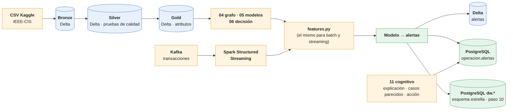

# Detección de fraude en transacciones digitales · versión corregida en Spark

Proyecto de punta a punta con datos reales (IEEE-CIS / Vesta, 590,540 transacciones, 3.5% fraude):
lakehouse en **Delta Lake**, **Spark** para todo el procesamiento, **Kafka** para el flujo en tiempo real,
**PostgreSQL** como base operativa y como **data warehouse** en estrella, y una capa de modelos
matemáticos, estocásticos, de matemáticas discretas y de cómputo cognitivo encima.

> Esta versión corrige los cuatro problemas que encontró la auditoría del proyecto original
> (`01_auditoria_modelo_fraude.ipynb`): datos sintéticos con una regla obvia (monto > 1500),
> partición aleatoria, atributos distintos entre entrenamiento y streaming, y umbral sin costo.

## Arquitectura



## Cómo correrlo

```bash
docker compose up -d                 # Kafka + PostgreSQL
pip install -r requirements.txt      # requiere Java 17 o 21
export RUTA_IEEE=/ruta/a/ieee-cis    # opcional: si no, se descarga con kagglehub
./correr_todo.sh                     # ~45 min en una laptop de 2 núcleos / 8 GB
```

| Paso | Qué hace | Tema |
|---|---|---|
| `01_bronze.py` | CSV → Delta tal cual, con metadatos de ingesta | Delta Lake |
| `02_silver.py` | Unión transacción + identidad, tipos, duplicados, **pruebas de calidad** registradas en una tabla Delta, partición temporal | Ingeniería de datos |
| `03_gold.py` | Atributos **en el punto del tiempo** (solo pasado) con ventanas de Spark | Spark |
| `04_grafo.py` | Grafo bipartito cliente–dispositivo, componentes conexas, modelo nulo | Matemáticas discretas |
| `05_modelos.py` | GBT y regresión logística en Spark MLlib, ablación, comparación estilo Kaggle, calibración de Platt | ML |
| `06_decision.py` | Regla de Bayes, mochila con capacidad, colas M/M/c + simulación Monte Carlo | Modelos matemáticos y estocásticos |
| `07_productor_kafka.py` | Publica el mes de prueba en Kafka (sin la etiqueta) | Streaming |
| `08_consumidor_streaming.py` | Lee Kafka por micro-lotes, calcula atributos con **el mismo módulo**, puntúa y escribe en Delta + PostgreSQL | Streaming |
| `09_paridad.py` | Prueba automática: streaming y batch deben dar la misma probabilidad | Calidad |
| `10_data_warehouse.py` | Esquema estrella en PostgreSQL + consultas OLAP (ROLLUP, GROUPING SETS, ventanas) | Data warehouse |
| `11_cognitivo.py` | Explicación en español, razonamiento con casos parecidos (k-NN) y reglas de experto | Cómputo cognitivo |

## Decisiones de diseño que evitan las fugas de información

1. **Partición temporal**: entreno días 1–120, validación 121–150, prueba 151–183. Con partición aleatoria
   el PR-AUC sube artificialmente (0.85 vs 0.55 en el notebook 02) porque el 84% de los fraudes de prueba
   vienen de clientes que ya defraudaron en entrenamiento.
2. **Retraso de etiqueta de 30 días**: en la vida real un fraude se confirma semanas después (contracargo).
   Los atributos de "riesgo histórico" solo usan fraudes de transacciones con más de 30 días de antigüedad,
   y ninguna etiqueta posterior al día 150. Verificado en el paso 03: 0 etiquetas de prueba visibles.
3. **Un solo `features.py` para batch y streaming**. El proyecto original calculaba los atributos de dos
   formas distintas. Ahora el paso 09 lo comprueba: **diferencia máxima 0** en 94,635 transacciones.
4. **La elección de modelo y de umbral usa solo validación**; el mes de prueba se mira una vez, al final.

## Resultados (mes de prueba, 94,635 transacciones, 3,282 fraudes)

### Modelos (`reporte/05_modelos.csv`)

| Modelo | PR-AUC val. | PR-AUC prueba | ROC-AUC | Recall revisando 3.35% |
|---|---|---|---|---|
| GBT 1 · columnas originales | 0.502 | 0.461 | 0.890 | 46.1% |
| GBT 2 · + historial del cliente | 0.465 | 0.397 | 0.874 | 41.3% |
| GBT 3 · + Poisson, grafo, riesgo con retraso | 0.556 | 0.488 | 0.903 | 48.0% |
| **Regresión logística (conjunto 3) — elegido** | **0.582** | **0.558** | **0.922** | **53.6%** |
| GBT estilo Kaggle (usa el futuro, no desplegable) | — | 0.390 | 0.870 | 41.3% |

Lectura honesta:
- **Ganó la regresión logística**, elegida por validación (no por prueba). El GBT de Spark se detiene
  solo a los 26–79 árboles porque la parada temprana mira la log-loss ponderada, que deja de bajar
  aunque el orden de los puntajes todavía mejore. LightGBM en el notebook 02 llegó a 0.552: con Spark
  MLlib el árbol no alcanza a una logística bien preparada.
- Agregar el historial del cliente **empeoró** el GBT (0.461 → 0.397). Solo con el riesgo con retraso
  y Poisson se recupera. No todo atributo "inteligente" ayuda; la ablación es lo que lo demuestra.
- Grafo y Poisson aportan casi nada de importancia al GBT (0.000 y 0.003). Sirven para explicar e
  investigar (anillos), no para subir la métrica.
- El 0.96 del primer lugar de Kaggle **no es comparable**: se midió con partición aleatoria del público
  y con agregados que usan todo el historial del cliente, incluido el futuro y el conjunto de prueba.

### Matemáticas discretas · grafo (`reporte/04_grafo.json`, `figuras/04_anillo.png`)
- 46,060 clientes y 34,247 huellas de dispositivo, 72,219 aristas (se quitan 117 dispositivos "hub").
- **219 componentes con 2 o más clientes defraudadores**, contra 74 esperadas al azar (p95 = 88) en un
  modelo nulo que reparte el fraude con la misma tasa: hay anillos reales, ~3 veces más que el azar.
- Tasa de fraude dentro de anillos 13.0% vs 6.0% de base.
- Solo se ven con la huella fina (DeviceInfo + navegador + resolución + SO); con DeviceInfo solo, no.

### Modelos de decisión (`reporte/06_decision.json`, `figuras/06_decision.png`)
- **Regla de Bayes** (revisar si p·monto ≥ $3 de costo): revisa 22% y recupera 93% del monto; ahorro 80%
  frente a no revisar. Es el óptimo si no hay límite de analistas.
- **Mochila con capacidad de 3.35%**: con el mismo equipo, ordenar por **pérdida esperada (p·monto)**
  recupera **63% del dinero** vs 42% ordenando por probabilidad y 36% por monto. Atrapa menos fraudes
  (1,097 vs 1,760) pero más grandes: hay que decidir qué métrica le importa al negocio.
- **Colas M/M/c (Erlang C)**: ~104 alertas al día; se necesitan 1 analista de 5 a 11 h, 2 la mayor parte
  del día y 3 a las 20 h para que menos del 20% espere más de 15 min. La simulación Monte Carlo confirma
  la fórmula (espera media 1.18 vs 1.19 min en la hora pico).

### Streaming (`reporte/09_paridad.json`)
- 94,635 eventos de Kafka en 5 micro-lotes, 3,426 alertas (3.6%), precisión 33.7%, recall 35.2%.
- Paridad batch–streaming: diferencia máxima 0, todas las decisiones iguales.
- La tasa de alertas subió de 3.3% a 4.0% en los últimos lotes: el umbral fijo de validación se desajusta
  con el tiempo. En producción hay que recalibrarlo (o fijar un cupo diario).

### Data warehouse (`reporte/10_*.csv`, `reporte/10_consultas.sql`)
Esquema estrella `dw` con `fact_transaccion` (590,540 filas) y dimensiones de tiempo, producto, tarjeta,
canal y correo. Hallazgos:
- Productos C y H con 12–13% de fraude vs W con 2%.
- Tarjeta de crédito en móvil: 13.9% de fraude, vs 1.6% en débito sin datos de dispositivo.
- outlook.com 9.5%, hotmail 5.3%, gmail 4.4%.
- La precisión del modelo baja de 46% (primera semana de validación) a ~31–37% en prueba: el deterioro
  se puede vigilar semana a semana desde el warehouse.

### Cómputo cognitivo (`reporte/11_cognitivo.json`, columnas en `operacion.alertas`)
Cada alerta queda en PostgreSQL con tres campos para el analista:
- **Explicación** en español: los rasgos en los que la transacción es más rara (percentil) y cuánto más
  común es el fraude en ese grupo. Ej.: *"el cliente ya tuvo fraude confirmado (riesgo 54%)… en ese grupo
  el fraude es 27 veces más común"*.
- **Casos parecidos**: los 7 casos ya resueltos más cercanos y cuántos fueron fraude.
- **Acción sugerida** por reglas de experto: "Bloquear" → 86% eran fraude real; "Revisar de inmediato" →
  61%; "Cola normal" → 13%.

Lectura honesta: los casos parecidos **no mejoran el orden** de las alertas (ROC-AUC 0.877 combinado vs
0.881 solo el modelo). Su valor es dar al analista precedentes concretos, no más precisión.

## Qué aporté de las soluciones ganadoras de Kaggle
- **UID** (card1 + addr1 + día − D1) para identificar al cliente, y **D normalizadas** (día − D).
- **Agregados por cliente** (medias de C, D y monto). Aquí se calculan solo con el pasado; la versión
  estilo Kaggle (con futuro) se deja como comparación para mostrar por qué no es desplegable.
- No se usó la selección de columnas V del primer lugar completa (339 columnas): se tomaron 20.

## Limitaciones
- 20 de 339 columnas V; mejorar eso y el GBT (o pasar a LightGBM/XGBoost sobre Spark) es el siguiente paso.
- El costo de revisión ($3) y los 10 minutos por caso son supuestos, no datos de Vesta.
- La identidad del cliente (UID) es una aproximación: Vesta no publica un ID de cliente.
